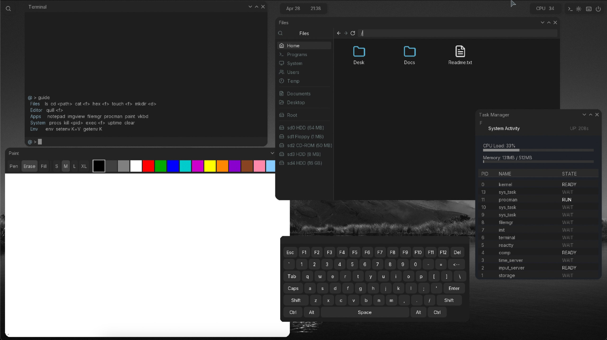

<p align="center">
  
</p>

<h1 align="center">Sodium</h1>

<p align="center">
  A graphical operating system written from scratch in C, targeting AArch64.
  <br>
  Preemptive multitasking, compositing window manager, IPC, FAT32 filesystem, and a full suite of GUI applications.
</p>

<p align="center">
  
  
  
</p>

---

## Overview

Sodium is a graphical OS for AArch64 written in C from scratch — no libc, no POSIX, no external runtime dependencies.

Userspace processes run as separate AArch64 `.qex` executables with their own address spaces, communicating over IPC. The desktop compositor, shell, and all applications are regular userspace processes.

### Included apps

Terminal, File Manager, Notepad, Paint, Image Viewer, Process Manager, Virtual Keyboard, Memory Map, Fetch.

---

## Prerequisites

| Tool | Purpose |
|------|---------|
| `aarch64-elf-gcc` | Cross-compiler toolchain |
| `qemu-system-aarch64` | Emulator |
| U-Boot `qemu_arm64` build | ARM bootloader firmware |
| `mkimage` (`u-boot-tools`) | U-Boot boot script image |
| `mtools` (`mcopy`, `mmd`) | FAT32 disk image files |
| `dosfstools` (`mkfs.fat`) | FAT filesystem creation |
| `python3` + `pillow` + `fonttools` | Asset baking scripts |

### macOS

```bash
brew install aarch64-elf-gcc qemu u-boot-tools mtools dosfstools python3
pip3 install pillow fonttools
```

Makefile locates Homebrew `dosfstools` automatically when `mkfs.fat` is outside `PATH`.

### Linux (Ubuntu/Debian)

```bash
sudo apt install gcc-aarch64-linux-gnu qemu-system-arm u-boot-tools mtools dosfstools python3 python3-pip
pip3 install pillow fonttools
```

> Note: On Linux, set `CROSS=aarch64-linux-gnu-` when building:
> ```bash
> make image CROSS=aarch64-linux-gnu-
> ```

### Windows

Use [MSYS2](https://www.msys2.org/) with the MinGW64 environment:

```bash
pacman -S mingw-w64-x86_64-qemu mingw-w64-x86_64-mtools python3 python3-pip
pip3 install pillow fonttools
```

Install the AArch64 bare-metal toolchain from [Arm GNU Toolchain Downloads](https://developer.arm.com/downloads/-/arm-gnu-toolchain-downloads) and add it to your PATH.

Alternatively, use WSL2 with Ubuntu and follow the Linux instructions above.

---

## Build

```bash
make clean
make image
```

This compiles Sodium, builds all userspace `.qex` binaries, bakes font/icon/wallpaper assets, and assembles an MBR-partitioned FAT32 boot disk (`sodium.img`).

---

## Run

Build RAM-linked U-Boot for QEMU ARM virt once, then place its firmware at `u-boot.bin`. macOS build tools: `brew install make bison bash openssl@3`; use `gmake` and export Homebrew OpenSSL paths:

```bash
git clone --depth 1 https://source.denx.de/u-boot/u-boot.git /tmp/u-boot
OPENSSL_PREFIX="$(brew --prefix openssl@3)"
export PATH="$(brew --prefix make)/libexec/gnubin:$(brew --prefix bison)/bin:$(brew --prefix bash)/bin:$PATH"
export HOSTCFLAGS="-I$OPENSSL_PREFIX/include"
export HOSTLDFLAGS="-L$OPENSSL_PREFIX/lib"
export PKG_CONFIG_PATH="$OPENSSL_PREFIX/lib/pkgconfig"
gmake -C /tmp/u-boot qemu_arm64_defconfig
/tmp/u-boot/scripts/config --file /tmp/u-boot/.config --set-val CONFIG_TEXT_BASE 0x40200000
/tmp/u-boot/scripts/config --file /tmp/u-boot/.config --set-val CONFIG_CUSTOM_SYS_INIT_SP_ADDR 0x40400000
gmake -C /tmp/u-boot olddefconfig
gmake -C /tmp/u-boot CROSS_COMPILE=aarch64-elf-
cp /tmp/u-boot/u-boot.bin ./u-boot.bin
```

On Linux, use `make` instead of `gmake` and `CROSS_COMPILE=aarch64-linux-gnu-`. Set `UBOOT=/path/to/u-boot.bin` to use firmware at another path. U-Boot links at `0x40200000`; QEMU generic loader places it in RAM and sets CPU entry, avoiding HVF's flash-MMIO abort. Image build creates an MBR-partitioned FAT32 disk containing Sodium kernel and U-Boot script. U-Boot loads and starts kernel. Sodium storage driver mounts FAT partition through its partition offset.

### Software emulation (recommended)

```bash
make run-tcg
```

### Hardware virtualization (macOS Apple Silicon)

```bash
make run-hvf
```

### Headless (serial only, no GUI window)

```bash
make run
```

### Multi-disk (attaches floppy, CD-ROM, USB images)

```bash
make run-hvf-multi
```

---

## Terminal Commands

The built-in shell (`reactty`) supports command history (arrow keys) and these commands:

| Command | UNIX alias | Description |
|---------|------------|-------------|
| `list` | `ls` | List directory contents or mounted disks |
| `jump <path>` | `cd` | Change directory (`..`, `/`, `sd0`–`sd9`) |
| `beam <file>` | `cat` | Print file contents |
| `dump <file>` | `hex` | Hex dump of a file |
| `spawn <file>` | `touch` | Create empty file |
| `hatch <dir>` | `mkdir` | Create directory |
| `quill <file>` | `nano` | Inline text editor (`.save`, `.quit`) |
| `run <file>` | `exec` | Load and run a `.qex` binary |
| `procs` | — | List running processes |
| `kill <pid>` | — | Send signal to process |
| `uptime` | — | Show system uptime |
| `purge` | `clear` | Clear terminal |
| `env` | — | Show environment variables |
| `setenv K=V` | — | Set environment variable |
| `getenv K` | — | Get environment variable |
| `mnt [sdN]` | `mount` | List or mount a disk |
| `unmnt <sdN>` | `unmount` | Eject a disk |
| `notepad` | — | Launch Notepad app |
| `imgview [file]` | — | Launch Image Viewer |
| `filemgr` | — | Launch File Manager |
| `procman` | — | Launch Process Manager |
| `paint` | — | Launch Paint |
| `vkbd` | — | Launch Virtual Keyboard |
| `guide` | `help` | Show command summary |

---

## Project Structure

```
src/
 ├── arch/aarch64/    Boot, MMU, GIC, VirtIO drivers, context switch
 ├── kernel/          Scheduler, syscalls, ELF loader, IPC, boot splash
 ├── fs/              FAT16/FAT32 driver
 ├── mm/              Physical/virtual memory, kmalloc
 ├── drivers/         Timer, framebuffer
 ├── gfx/             Font atlas, BMP decoder, input events
 ├── video/           Font rendering
 ├── lib/             stdlib, math, div64
 ├── user/            Userspace applications
 │   └── lib/         Userspace runtime library (syscall wrappers, GFX, windowing)
 └── util/            String and utility functions
tools/
  ├── font_baker.py    Bakes TTF into binary font atlas
  ├── icon_baker.py    Bakes Lucide icons into binary sprite sheet
  ├── wallpaper_baker.py  Converts BMP wallpaper to raw format
  ├── mbr_partition.py   Creates active FAT32 MBR partition
  ├── uboot/boot.cmd   U-Boot kernel load script
  └── qex_builder.py   Packages flat binaries into .qex executables
```

---

## Build Tools

| Script | Input | Output |
|--------|-------|--------|
| `font_baker.py` | `assets/sys/font.ttf` | `build/font_atlas.bin` |
| `icon_baker.py` | `tools/lucide.ttf` | `build/icons.bin` |
| `wallpaper_baker.py` | `assets/sys/wallpaper.bmp` | `build/wallpaper.bin` |
| `mbr_partition.py` | disk image, partition start LBA | active FAT32 MBR partition |
| `tools/uboot/boot.cmd` | U-Boot script source | `build/boot.scr` |
| `qex_builder.py` | flat binary | `.qex` executable |

---

## Disk Layout

```
sodium.img (MBR + FAT32, 64 MB)
 ├── Partition 1 (bootable)
 │   ├── SODIUM.BIN  Kernel image loaded by U-Boot
 │   └── BOOT.SCR    U-Boot load-and-start script
 │   ├── PRG/       Application executables (.qex)
 │   ├── SYS/
 │   │   ├── BIN/   hostname, version, fstab
 │   │   └── DAT/   font atlas, icons, wallpaper, logo
 │   ├── USR/
 │   │   └── DEFAULT/
 │   │       ├── DESK/ Desktop files
 │   │       └── DOCS/ Documentation
 │   └── TMP/       Temporary files
```

---

## License

[MIT](LICENSE) — Copyright (c) 2025-2026
